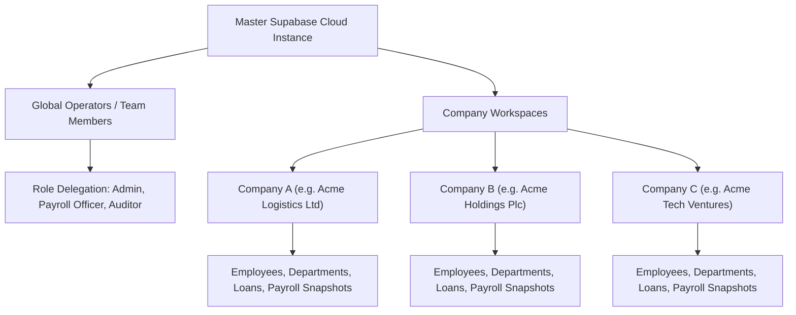

# Payroll Pro — System Administrator & Multi-Tenant Guide

This guide is designed for **System Administrators**, **IT Leads**, and **Financial Directors** managing company workspaces, security policies, operator access delegations, and cloud database infrastructure in **Payroll Pro**.

---

## Table of Contents

1. [Enterprise Architecture & Multi-Tenancy](#1-enterprise-architecture--multi-tenancy)
2. [Cloud Infrastructure Setup (Supabase PostgreSQL)](#2-cloud-infrastructure-setup-supabase-postgresql)
3. [Operator Access Control & RBAC Matrix](#3-operator-access-control--rbac-matrix)
4. [Live Presence & Real-Time Collaboration](#4-live-presence--real-time-collaboration)
5. [Instant Role Enforcement & Forced Deactivation](#5-instant-role-enforcement--forced-deactivation)
6. [Security, Passwords & Account Recovery](#6-security-passwords--account-recovery)
7. [Enterprise Audit Trail & Compliance Logging](#7-enterprise-audit-trail--compliance-logging)
8. [Backup, Disaster Recovery & Idempotent Migrations](#8-backup-disaster-recovery--idempotent-migrations)

---

## 1. Enterprise Architecture & Multi-Tenancy

Payroll Pro uses a hierarchical multi-tenant architecture designed to support corporate groups, holding companies, accounting firms, and single independent entities alike.



### Isolation Boundary
- Each company workspace maintains its own isolated staff records, salary structures, loan ledgers, tax parameters, and locked historical payroll snapshots.
- Operators authenticate once against the global system and access authorized company workspaces using individual workspace access PINs or passwords.

---

## 2. Cloud Infrastructure Setup (Supabase PostgreSQL)

Payroll Pro integrates with **Supabase** (PostgreSQL 14+) for low-latency relational storage and WebSocket change-data-capture (CDC).

### 2.1 Connecting a Supabase Project
1. Log into your [Supabase Dashboard](https://supabase.com).
2. Create a new project (e.g., `payroll-pro-production`).
3. Under **Project Settings -> API**, copy:
   - **Project URL:** `https://xyzcompany.supabase.co`
   - **Anon Public API Key:** `eyJhbGciOiJIUzI1NiIsInR5cCI6IkpXVCJ9...`
4. Launch Payroll Pro and click **Connect Server** on the login gate.
5. Paste the URL and Anon Key, then click **Test & Connect**.

---

### 2.2 Database Initialization & Schema Migration
The complete, idempotent schema is located at [`schema.sql`](file:///c:/Users/USER/Desktop/Payroll%20Pro/schema.sql). 

#### Steps to Apply Schema:
1. Open the Supabase **SQL Editor**.
2. Create a new query and paste the contents of `schema.sql`.
3. Click **Run**.
4. The script creates all 10 core relational tables, foreign key constraints with `CASCADE DELETE`, default data triggers, and enables the `realtime` publication:
   ```sql
   ALTER PUBLICATION supabase_realtime ADD TABLE public.companies;
   ALTER PUBLICATION supabase_realtime ADD TABLE public.team_members;
   ALTER PUBLICATION supabase_realtime ADD TABLE public.employees;
   ALTER PUBLICATION supabase_realtime ADD TABLE public.employee_loans;
   ALTER PUBLICATION supabase_realtime ADD TABLE public.payroll_snapshots;
   ALTER PUBLICATION supabase_realtime ADD TABLE public.audit_logs;
   ```

---

## 3. Operator Access Control & RBAC Matrix

Payroll Pro enforces a strict three-tier **Role-Based Access Control (RBAC)** model:

| Capability / Action | Admin | Payroll Officer | Auditor |
| :--- | :---: | :---: | :---: |
| **Manage Cloud Connection & Server Keys** | ✅ Yes | ❌ No | ❌ No |
| **Create, Rename & Delete Companies** | ✅ Yes | ❌ No | ❌ No |
| **Manage Team Members & Passwords** | ✅ Yes | ❌ No | ❌ No |
| **Change Operator Access Roles** | ✅ Yes | ❌ No | ❌ No |
| **View Audit Trail & Security Logs** | ✅ Yes | ❌ No | ✅ Yes (Read-Only) |
| **Add, Edit & Deactivate Employees** | ✅ Yes | ✅ Yes | ❌ No (Read-Only) |
| **Run & Calculate Monthly Payroll** | ✅ Yes | ✅ Yes | ❌ No (Read-Only) |
| **Lock / Finalize Payroll Periods** | ✅ Yes | ✅ Yes | ❌ No |
| **Disburse & Amortize Staff Loans** | ✅ Yes | ✅ Yes | ❌ No (Read-Only) |
| **Export Bank Payment Schedules** | ✅ Yes | ✅ Yes | ✅ Yes (Audit Copy) |
| **Batch Print / PDF Payslips** | ✅ Yes | ✅ Yes | ✅ Yes (Audit Copy) |
| **Configure Tax Brackets & Statutory Variables** | ✅ Yes | ❌ No | ❌ No |
| **Perform Factory Reset / Data Wipe** | ✅ Yes | ❌ No | ❌ No |

---

## 4. Live Presence & Real-Time Collaboration

When multiple operators or managers use Payroll Pro across different computers:
- **WebSocket Presence Channels:** Broadcast operator login events with millisecond latency.
- **Online Indicators:** The Authorized Team Members ledger shows real-time green pulsing badges (`● Online since 09:14 AM — Acme Logistics`) or gray offline badges.
- **Concurrency Protection:** Informs operators if another team member is actively viewing or modifying the current payroll period.

---

## 5. Instant Role Enforcement & Forced Deactivation

To prevent security breaches from departing or compromised employees:
- **Zero-Latency Deactivation:** When an Administrator toggles an operator's status to **Deactivated** or demotes their role in `TeamMembersPage.tsx`, Supabase broadcasts a real-time CDC event.
- **Instant Client Action:** Within **sub-seconds**, the targeted operator's application immediately halts active operations, displays a security modal (*"Your account has been deactivated by an administrator"*), and signs out to the login gate.

---

## 6. Security, Passwords & Account Recovery

### 6.1 Administrator & Operator Credentials
- Passwords are encrypted before storage.
- First-time setup creates the Master Administrator with an enforced security question and answer.

### 6.2 Forgot Password & Self-Service Recovery
1. If an operator forgets their password, they click **Forgot Password?** on the login gate.
2. The system prompts for their registered **Username or Email**.
3. It retrieves their confidential **Security Question** (e.g., *"What was the name of your first school?"*).
4. Providing the correct answer unlocks the account and forces an immediate password reset.

### 6.3 Administrator Password Reset
Administrators can generate a one-time temporary recovery code (e.g., `PAY-749102`) for any operator via the team management interface. Upon next login, the operator is required to set a new confidential password before accessing workspaces.

---

## 7. Enterprise Audit Trail & Compliance Logging

All significant actions across all companies are automatically recorded in the immutable `audit_logs` table.

### Logged Events Include:
- Operator Logins, Failed Password Attempts, and Logouts.
- Employee Created, Edited, Prorated, or Deactivated.
- Base Salary Adjustments and Monthly Overrides.
- Loan Facilities Disbursed, Paused, Resumed, or Manually Repaid.
- Payroll Periods Locked, Finalized, or Exported.
- Tax Brackets, CRA Formulations, or Statutory Pension Rates Modified.
- Company Workspaces Created, Renamed, or Deleted.

Each entry records the **Actor Name**, **Actor Role**, **Action Type**, **Target Entity**, **Detailed Diff**, and **Exact UTC / Local Timestamp**.

---

## 8. Backup, Disaster Recovery & Idempotent Migrations

### 8.1 Automated Local Backups
Under **Settings -> Data Backup**, click **Export Full Database Backup**. This downloads an encrypted `.json` payload containing all company configurations, employees, loan balances, locked snapshots, and audit history.

### 8.2 Disaster Recovery Procedure
In the event of hardware loss or database corruption:
1. Deploy a fresh Supabase database.
2. Run `schema.sql` to initialize tables.
3. In Payroll Pro, connect to the new Supabase instance.
4. Go to **Settings -> Restore from Backup**, choose your latest backup `.json` file, and click **Restore**.
5. All company workspaces and historical ledgers will be restored and verified within seconds.
