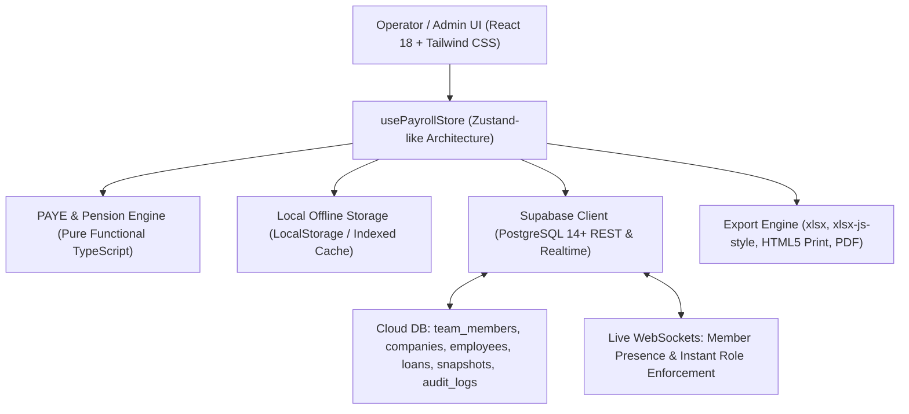

# Payroll Pro — Comprehensive Documentation Suite

Welcome to the official documentation for **Payroll Pro**, an enterprise-grade desktop and cloud-synchronized payroll and statutory compliance platform engineered specifically for Nigerian businesses, accounting firms, and multi-entity enterprises.

---

## Documentation Navigation

This documentation suite is organized into focused, modular manuals tailored for different stakeholders:

```
docs/
├── README.md                     <-- (You are here) Master Overview, Quick Start & System Index
├── USER_GUIDE.md                 <-- Complete End-User Manual (Page-by-Page Guides & Workflows)
├── ADMIN_GUIDE.md                <-- Workspace Setup, RBAC Security, Multi-Tenant Cloud Sync & Audits
└── STATUTORY_PAYROLL_ENGINE.md   <-- Regulatory Compliance, Tax Formulas (PITA/2026), Pension & Deductions
```

| Manual | Target Audience | Key Contents |
| :--- | :--- | :--- |
| [**User Guide**](USER_GUIDE.md) | Payroll Officers, HR Managers, Accountants | Dashboard KPIs, Employee Lifecycle, Monthly Payroll Runs, Salary Variations, Employee Loans, Payslip Customization, and Bank Payment Schedules. |
| [**Admin Guide**](ADMIN_GUIDE.md) | System Administrators, Managing Directors, IT Leads | Multi-Company Workspaces, Supabase Realtime Setup, Operator Access Control, Live Presence, Audit Trails, and Disaster Recovery. |
| [**Statutory Engine Guide**](STATUTORY_PAYROLL_ENGINE.md) | Compliance Officers, Tax Auditors, Financial Controllers | Mathematical breakdown of Nigerian PAYE tax (PITA 2011 & 2026 Tax Bill), Consolidated Relief Allowance (CRA), PRA 2014 BHT Pension, NHF, NSITF, and ITF. |

---

## System Overview & Architecture

Payroll Pro runs natively as an **Electron Windows Desktop Application** while also supporting modern web deployment via Vite/React. It couples a low-latency offline-first local cache (`LocalStorage`) with enterprise-grade **Supabase PostgreSQL & Realtime WebSockets** for live multi-user synchronization.



### Key Technical Specifications

- **Runtime Environment:** Windows x64 Native Desktop (Electron 44) & Modern Browsers (Chromium, Firefox, Edge).
- **Core Engine:** TypeScript 5.6, React 18.3, Vite 6.
- **Styling Architecture:** Tailwind CSS with fluid Dark / Light theme synchronization and high-contrast accessibility.
- **Backend & Realtime:** Supabase Cloud (PostgreSQL 14+, Row Level Security, Realtime CDC Postgres Changes, Presence Channels).
- **Export & Reporting:** Native Excel styling (`xlsx-js-style`), styled PDF printing, and instant payslip generation.

---

## Core Operational Highlights

1. **Dual-Mode Workspace Access:**
   - **Standalone Local Mode:** Run completely offline on a single machine with zero internet requirements.
   - **Cloud Synced Mode:** Connect to private Supabase instances for multi-operator, multi-branch collaboration.
2. **Instant Role & Deactivation Enforcement:**
   - If an Administrator promotes, demotes, or deactivates an operator from another computer, changes take effect on the operator's active window within **sub-seconds** without requiring an application reload.
3. **Statutory Accuracy for Nigeria:**
   - Pre-configured with Nigerian tax laws, including PITA 2011, Finance Act 2020, and the **2026 Nigerian Tax Reform Bill** progressive brackets.
   - Exact Pension Reform Act 2014 (PRA 2014) Basic + Housing + Transport (BHT) 8% Employee / 10% Employer calculations.
4. **Non-Destructive Background Synchronization:**
   - Silent polling and real-time database listener updates update data in-place without unmounting active forms, resetting inputs, or causing table layout flickering.
5. **Locked Period Snapshots:**
   - Finalized monthly payroll runs are cryptographically archived with immutable audit logs, protecting historical records against accidental retrospective changes.

---

## Keyboard Shortcuts & Power Navigation

| Shortcut | Scope | Action |
| :--- | :--- | :--- |
| `Alt + 1` | Global Workspace | Navigate to **Dashboard** |
| `Alt + 2` | Global Workspace | Navigate to **Staff Directory (Employees)** |
| `Alt + 3` | Global Workspace | Navigate to **Payroll Processing** |
| `Alt + 4` | Global Workspace | Navigate to **Loans & Salary Advances** |
| `Alt + 5` | Global Workspace | Navigate to **Payslip Designer** |
| `Alt + 6` | Global Workspace | Navigate to **Company Settings** |
| `Escape` | Modals & Menus | Dismiss active popup modal, dialog, or dropdown menu |
| `Enter` (in Quick-Add) | Quick-Add Form | Commit current row and immediately advance to the next staff row |
| `Ctrl + F` / Filter Focus | Staff / Payroll | Jump to search input to filter records by name, ID, or department |

---

## Quick Start Guide

### Step 1: Launch & Cloud Authentication
Upon opening Payroll Pro, enter your team credentials at the **Cloud & Staff Access Gate**. If setting up for the first time, click **Connect Server** to provide your Supabase URL and Anon Public Key, then register your Master Administrator profile.

### Step 2: Select or Create a Company Workspace
At the **Windows Account Picker**, select your company workspace card. Enter your workspace password (if configured). If creating a new entity, click **+ Add Company**, provide the legal entity name, RC number, and state of primary tax residence.

### Step 3: Populate Staff Records
Navigate to **Employees** (`Alt + 2`). Use **Add Employee** to onboard staff via either:
- **Quick-Add Spreadsheet:** Ideal for batch onboarding 10 to 100+ employees with automatic tab progression.
- **Standard Profile:** Detailed form for individual contracts, custom allowances, PFA/RSA numbers, bank details, and start/exit dates.

### Step 4: Run Monthly Payroll
Navigate to **Payroll** (`Alt + 3`). Select the active month and year from the top period picker. Review the real-time gross-to-net calculations, apply loan deductions, and click **Lock Period Snapshot** once approved.

### Step 5: Export & Disburse
From the payroll screen:
- Click **Export Bank Schedule** to generate standard Excel schedules for corporate internet banking upload (Access, Zenith, GTB, UBA, FirstBank, etc.).
- Click **Batch Print / PDF** to generate beautiful, branded payslips for all staff.
